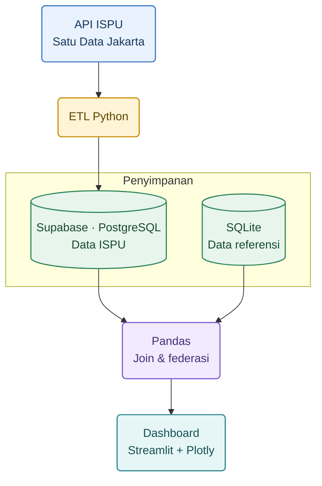

# Dashboard ISPU DKI Jakarta

Dashboard interaktif Streamlit untuk dataset ISPU harian terbaru DKI Jakarta yang tersedia di portal Satu Data Jakarta. Aplikasi memisahkan dua DBMS dan melakukan federasi/join di tingkat aplikasi:

- **Supabase PostgreSQL** menyimpan pengukuran harian yang bertambah dari waktu ke waktu.
- **SQLite** yang ikut di repositori menyimpan referensi kecil stasiun, kategori ISPU, dan sitasinya.
- **pandas** menggabungkan tabel PostgreSQL dan SQLite sebelum visualisasi Plotly.

## Fitur

- Filter rentang tanggal, stasiun, dan parameter.
- Gauge ISPU terbaru, tren dengan range slider, heatmap kalender per tahun, perbandingan antarstasiun, dan peta.
- Pratinjau CSV lokal opsional; berkas unggahan hanya diproses di sesi Streamlit dan tidak disimpan ke Supabase.
- API publik resmi dan impor ulang data melalui CLI.

## Ringkasan Arsitektur

### Diagram alur


    
### Peran kedua DBMS

| DBMS | Engine dan konektor | Data yang disimpan | Fungsi |
|---|---|---|---|
| **Supabase PostgreSQL** | PostgreSQL terkelola; SQLAlchemy dengan driver `psycopg` | Pengukuran ISPU per tanggal dan stasiun: PM₂.₅, PM₁₀, CO, SO₂, NO₂, O₃, nilai maksimum, kategori, parameter kritis, dan periode data | Menyimpan data pengukuran utama yang bertambah atau diperbarui dari sumber resmi. |
| **SQLite** | SQLite embedded; konektor standar Python `sqlite3` | Referensi kode/nama stasiun, wilayah, koordinat perkiraan, kategori/rentang ISPU, saran umum, dan sumber referensi | Menyediakan data pendamping berukuran kecil yang stabil dan ikut dikemas bersama aplikasi. |

Kedua database tetap terpisah. PostgreSQL tidak melakukan foreign key ke SQLite; hubungan data dibentuk di lapisan aplikasi berdasarkan kode/nama stasiun dan label kategori.

### Alur integrasi data

1. ETL mengambil snapshot dari API resmi Satu Data Jakarta atau CSV yang diberikan pengguna.
2. **Pandas** membersihkan kolom dan nilai, menyusun tanggal penuh dari `periode_data` dan nomor `tanggal` bila perlu, melewati tanggal kalender yang tidak valid, serta menghapus duplikat tanggal/stasiun.
3. ETL menulis data pengukuran ke tabel `ispu_harian` di Supabase PostgreSQL menggunakan SQLAlchemy dan psycopg.
4. Saat aplikasi berjalan, kueri PostgreSQL memuat pengukuran; `sqlite3` membaca referensi stasiun dan kategori dari SQLite.
5. Modul federasi menggunakan `pandas.merge()` untuk mencocokkan pengukuran dengan referensi di memori aplikasi. Inilah penggabungan lintas-DBMS (data federation) pada tingkat aplikasi.
6. Streamlit menyajikan hasil gabungan dalam grafik Plotly. Pengunggahan CSV di panel sidebar adalah jalur pratinjau alternatif dan tidak membaca pengukuran dari PostgreSQL untuk sesi tersebut.

### Interaktivitas visualisasi

- Filter rentang tanggal, stasiun, dan parameter pencemar.
- Pilihan tahun untuk heatmap kalender.
- Grafik tren harian Plotly dengan range slider dan tombol rentang waktu.
- Gauge ISPU terbaru, perbandingan rata-rata antarestasiun, peta interaktif, ringkasan kategori, serta tabel hasil federasi.
- Unggah CSV untuk pratinjau lokal jika koneksi PostgreSQL belum dikonfigurasi.

## Menjalankan dashboard

1. Gunakan Python 3.10+ dan pasang dependensi:

   ```powershell
   python -m pip install -r requirements.txt
   ```

2. Buat basis data referensi SQLite:

   ```powershell
   python scripts\build_reference_db.py
   ```

   Basis data `data\reference.db` juga sudah disertakan. Jalankan skrip kembali bila ingin membuat ulang.

3. Buat proyek Supabase dan jalankan isi [`sql/schema.sql`](sql/schema.sql) di SQL Editor.

4. Salin `.streamlit\secrets.toml.example` menjadi `.streamlit\secrets.toml`, lalu isi URL koneksi PostgreSQL Supabase. URL ini rahasia dan tidak boleh masuk commit atau repositori publik. Untuk koneksi produksi, gunakan pooler Supabase jika koneksi IPv6/direct tidak tersedia.

5. Impor dataset terbaru dari endpoint umum portal:

   ```powershell
   $env:DATABASE_URL = "postgresql://..."
   python -m ispu_dashboard.etl
   ```

   Secara default CLI mengambil endpoint JSON resmi Satu Data Jakarta untuk dataset umum ISPU. Untuk file CSV yang diunduh dari portal:

   ```powershell
   python -m ispu_dashboard.etl --source "C:\path\ke\ispu-terbaru.csv"
   ```

   ETL menyusun tanggal dari `periode_data` (tahun-bulan) dan `tanggal` (nomor hari) jika sumber tidak memberikan tanggal lengkap. Tanggal kalender tidak valid seperti 31 September akan dilewati dan dilaporkan; nilai `-`/`N/A` menjadi kosong; duplikat tanggal/stasiun dibersihkan. Sebelum menulis, ETL mengganti seluruh isi `ispu_harian` dalam satu transaksi agar snapshot terbaru tidak tercampur dengan snapshot sebelumnya. Gunakan tabel ini khusus untuk dataset ISPU, dan buat cadangan lebih dahulu jika memiliki data lain di dalamnya. Jalankan ulang perintah ini untuk menyegarkan data.

   Pada pemeriksaan 30 Oktober 2026, endpoint mengembalikan 3.501 baris untuk 1 Januari 2024–30 November 2025; 3.500 memiliki tanggal kalender valid. Isi endpoint dapat berubah, sehingga tanggal akhir di dashboard mengikuti data yang terakhir diimpor dan tidak mengisi hari yang hilang.

6. Jalankan aplikasi:

   ```powershell
   streamlit run app.py
   ```

   Tanpa kredensial PostgreSQL, unggah CSV melalui panel samping untuk pratinjau. Dashboard aktif penuh membaca pengukuran dari PostgreSQL dan referensi dari SQLite.

## Deploy ke Streamlit Community Cloud

1. Push repositori ini ke GitHub, tanpa `.streamlit\secrets.toml` dan tanpa kredensial.
2. Buat aplikasi baru di Streamlit Community Cloud dengan entrypoint `app.py`.
3. Tambahkan `DATABASE_URL` ke menu **App settings → Secrets**. Gunakan koneksi PostgreSQL Supabase yang aktif dan aman; jangan memasukkannya di kode atau README.
4. Deploy. Buat/isi tabel PostgreSQL dan jalankan CLI ETL dari komputer tepercaya sebelum membuka dashboard ke publik.

Deployment publik memerlukan akun GitHub, proyek Supabase, dan konfigurasi Streamlit Cloud pemilik aplikasi; akses tersebut tidak tersedia dari workspace ini.

## Memperbarui ke snapshot terbaru

Tidak perlu mengubah kode atau mengganti tahun secara manual. Pastikan `DATABASE_URL` mengarah ke Supabase yang benar, lalu jalankan:

```powershell
python -m ispu_dashboard.etl
```

Perintah tersebut mengambil dataset umum (tanpa akhiran `-2023`) dari endpoint resmi, menormalkan format tanggal, kemudian mengganti snapshot dalam tabel PostgreSQL. Setelah berhasil, muat ulang dashboard. Streamlit membaca seluruh rentang tanggal yang ada; filter tanggal dan pilihan tahun kalender menyesuaikan data yang sudah dimuat. ETL **tidak** berjalan otomatis berkala—jalankan lagi saat ingin menyegarkan.

Jika mengunduh CSV secara manual dari halaman dataset umum, unggah CSV sebagai `--source`; pastikan CSV berisi `periode_data`, `tanggal`, dan `stasiun` bila kolom tanggal hanya berisi nomor hari. Halaman dataset: [Data ISPU DKI Jakarta](https://satudata.jakarta.go.id/open-data/detail?kategori=dataset&page_url=data-indeks-standar-pencemar-udara-ispu-di-provinsi-dki-jakarta&data_no=1).

Tabel `ispu_harian`:

| Kolom | Makna |
|---|---|
| `tanggal`, `periode_data`, `stasiun` | Tanggal pengamatan, periode, dan nama stasiun |
| `pm25`, `pm10`, `so2`, `co`, `o3`, `no2` | Indeks parameter pencemar dari sumber |
| `nilai_maks`, `parameter_kritis`, `kategori` | Nilai maksimum, parameter kritis, dan kategori ISPU |

Nilai `-` pada parameter diperlakukan sebagai data kosong, bukan nol. Stasiun dipadankan menggunakan kode DKI bila tersedia. Baris dengan stasiun yang tidak ada di referensi tetap ditampilkan tanpa metadata lokasi.

Koordinat peta SQLite merupakan **perkiraan kawasan**, bukan titik pasti alat sensor. Koordinat tersebut di-geocode dari OpenStreetMap Nominatim; label dan catatan aproksimasi disimpan di basis data referensi.

## Sumber dan atribusi

1. **Sumber primer pengukuran:** Pemerintah Provinsi DKI Jakarta, Satu Data Jakarta, *Data Indeks Standar Pencemar Udara (ISPU) di Provinsi DKI Jakarta*. [Halaman dataset](https://satudata.jakarta.go.id/open-data/detail?kategori=dataset&page_url=data-indeks-standar-pencemar-udara-ispu-di-provinsi-dki-jakarta&data_no=1). Endpoint JSON resmi yang digunakan oleh ETL:
   `https://ws.jakarta.go.id/gateway/DataPortalSatuDataJakarta/1.0/satudata?kategori=dataset&tipe=detail&url=data-indeks-standar-pencemar-udara-ispu-di-provinsi-dki-jakarta`
2. **Kategori ISPU:** Peraturan Menteri Lingkungan Hidup dan Kehutanan No. 14 Tahun 2020 tentang Indeks Standar Pencemar Udara. [JDIH/BPK](https://peraturan.bpk.go.id/Details/163460/permen-lhk-no-14-tahun-2020).
3. **Lokasi perkiraan peta:** [OpenStreetMap](https://www.openstreetmap.org/copyright) dan [Nominatim](https://nominatim.openstreetmap.org/). Koordinat hanya digunakan untuk menunjukkan kawasan perkiraan stasiun.

Periksa keterangan lisensi/pemanfaatan pada halaman dataset sebelum mendistribusikan ulang data mentah. Sitasi portal tetap dicantumkan di aplikasi dan dokumentasi.

## Validasi

```powershell
python -m unittest discover -s tests -v
```
